<div align="center">

# WANDERGO · 让我带你去世界

**手帐风旅行规划与社会化攻略平台**
AI 行程规划 · 地图点亮足迹 · 旅行转盘 · 社区攻略 · 打卡纪念册

[**在线体验**](https://tiamecho.github.io/bishe-wandergo/) · [后端接口](https://wandergo-backend-6i1z.onrender.com/api/health) · [设计总览](https://tiamecho.github.io/bishe-wandergo/index.html)


</div>

---

## 界面预览

| 手帐风地图 · 足迹点亮 | AI 行程规划 |
|---|---|
| 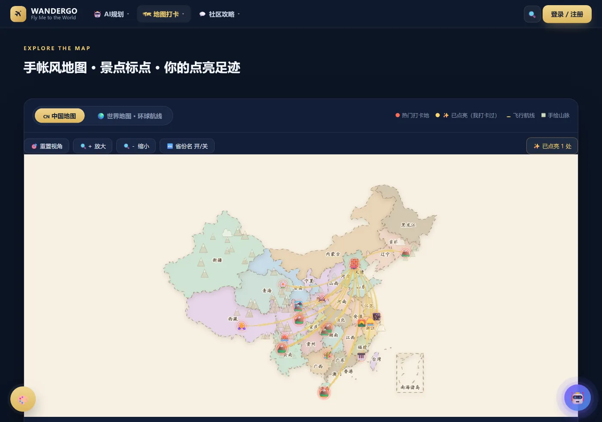 | 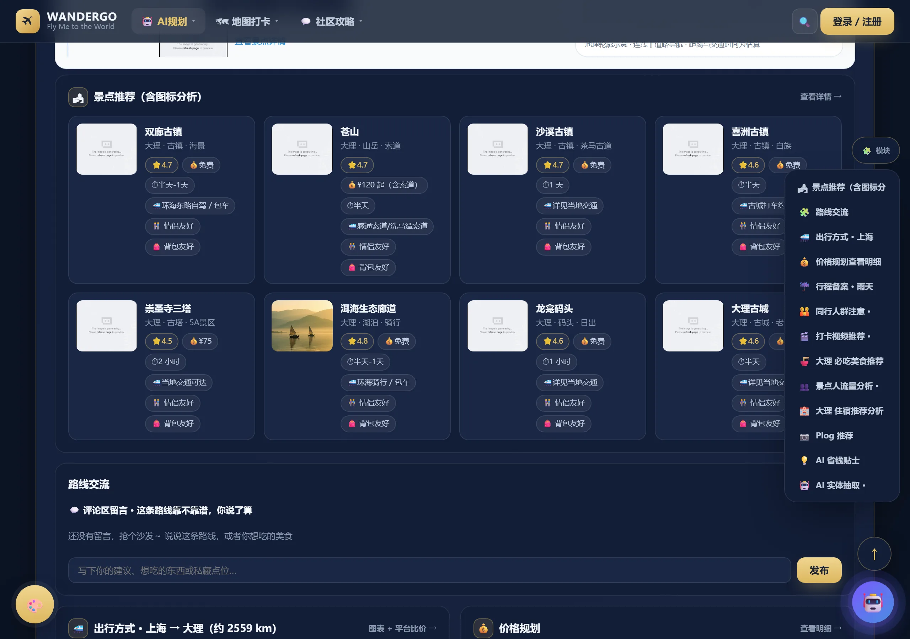 |

| 旅行大转盘 | 旅行社区 |
|---|---|
| 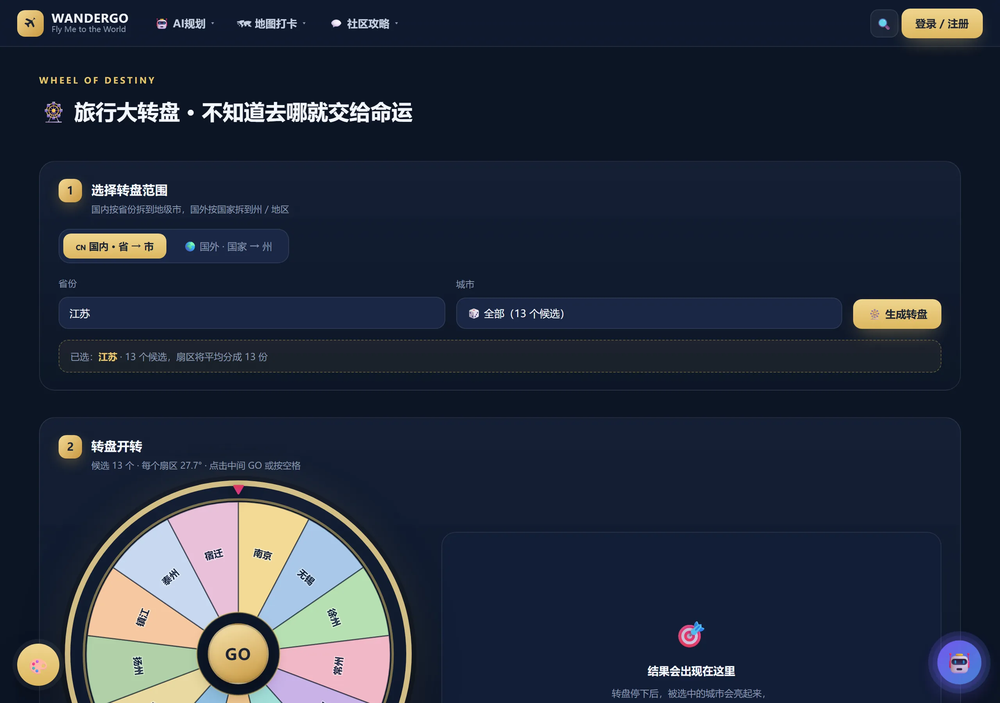 | 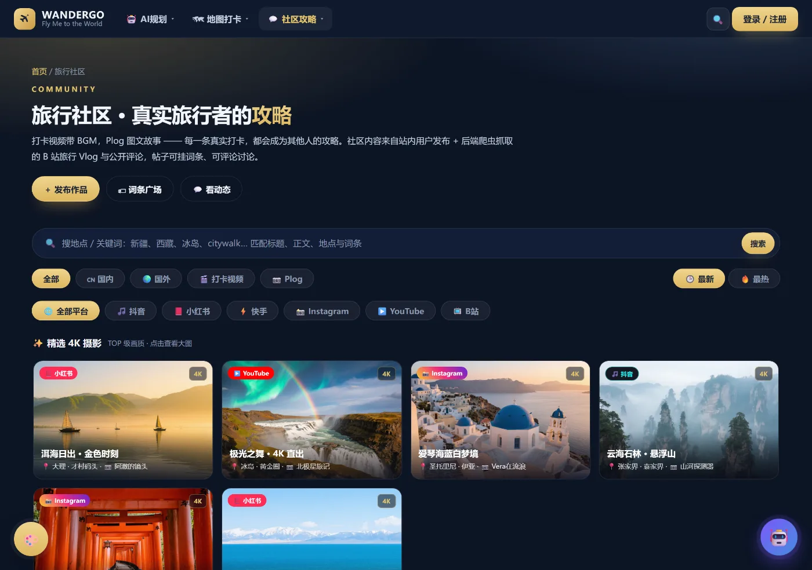 |

> 以上截图为线上真实运行效果，非设计稿。

---

## 一、项目简介

WANDERGO 是一个面向自由行用户的**旅行规划 + 攻略社区**一体化平台。它把「查攻略」「排行程」「打卡记录」「回顾纪念」串成闭环：用户搜索目的地攻略 → AI 按天数与偏好自动排出可执行行程 → 出行中打卡点亮地图 → 结束后生成可播放的旅行纪念册。

与传统攻略站不同，本系统强调三件事：

- **可执行**：行程不是景点罗列，而是带时刻、带预算、带交通分段、带天气与体力备案的日程表；
- **可解释**：每个景点为什么被排进这一天，由「扇形分区算法」给出依据（方位角 + 距离，由近及远不折返）；
- **可沉淀**：AI 从攻略文本中抽取的地名 / 美食 / 商圈会结构化入库，形成可检索的城市旅游资源图谱。

## 二、在线访问

| 入口 | 地址 | 说明 |
|---|---|---|
| 前端主站 | https://tiamecho.github.io/bishe-wandergo/ | GitHub Pages 托管，19 个功能页面 |
| AI 行程规划 | https://tiamecho.github.io/bishe-wandergo/ai.html | 表单 → 生成多日行程 |
| 手帐地图 | https://tiamecho.github.io/bishe-wandergo/map.html | 中国地图 / 世界环球航线 |
| 旅行转盘 | https://tiamecho.github.io/bishe-wandergo/wheel.html | 选择恐惧症友好 |
| 旅行社区 | https://tiamecho.github.io/bishe-wandergo/community.html | 多平台攻略聚合 |
| 源码仓库 | https://github.com/TiamEcho/bishe-wandergo | 开发主线分支 `deploy-1029` |
| 后端 API | https://wandergo-backend-6i1z.onrender.com/api/health | Express + PostgreSQL（Render 托管） |

> 后端为 Render 免费实例，冷启动约 30–50 秒，首次请求健康检查较慢属正常现象。
> 前端 `js/api.js` 会按环境自动切换：本地访问走 `http://localhost:8080`，线上访问走 Render 地址，也可用 `localStorage.setItem('wgo_api', '<自定义地址>')` 覆盖。

**当前线上数据规模**：攻略 125 篇 · 打卡记录 61 条 · 结构化实体 306 个 · 覆盖城市 23 个。

## 三、系统结构图

### 3.1 分层架构

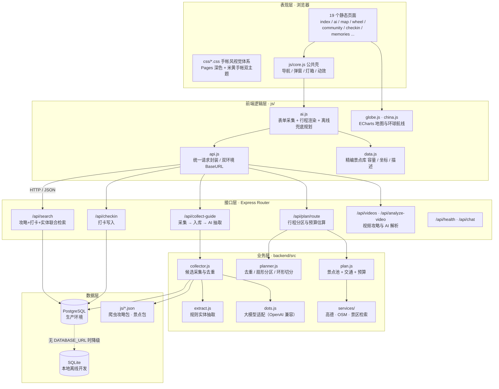

### 3.2 核心业务链路（时序）

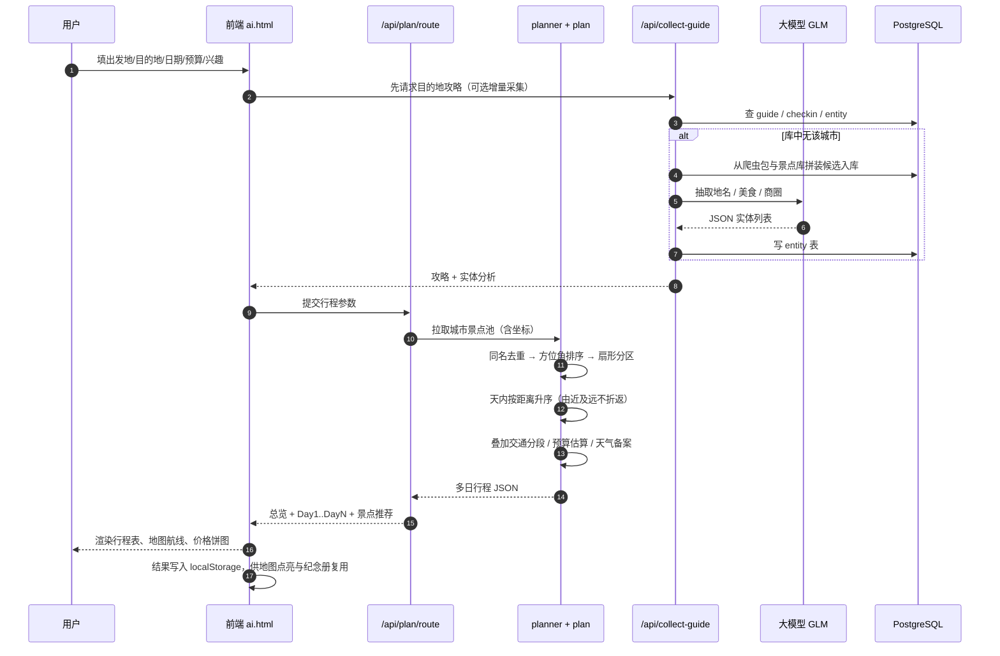

### 3.3 前端页面结构

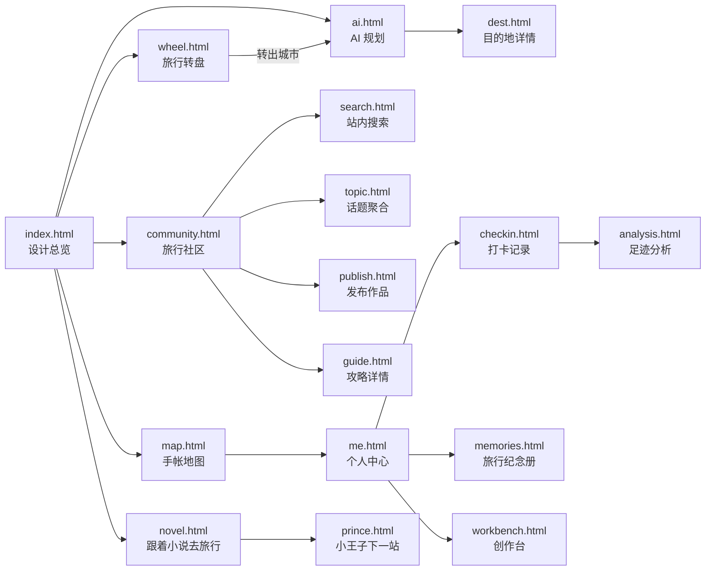

## 四、数据库设计

### 4.1 E-R 图

系统以「攻略文档」为核心实体：一篇攻略归属一个城市，可被抽取出多个结构化实体；用户打卡记录独立成表，通过城市字段与攻略、实体形成弱关联（便于跨来源聚合而不强耦合）。

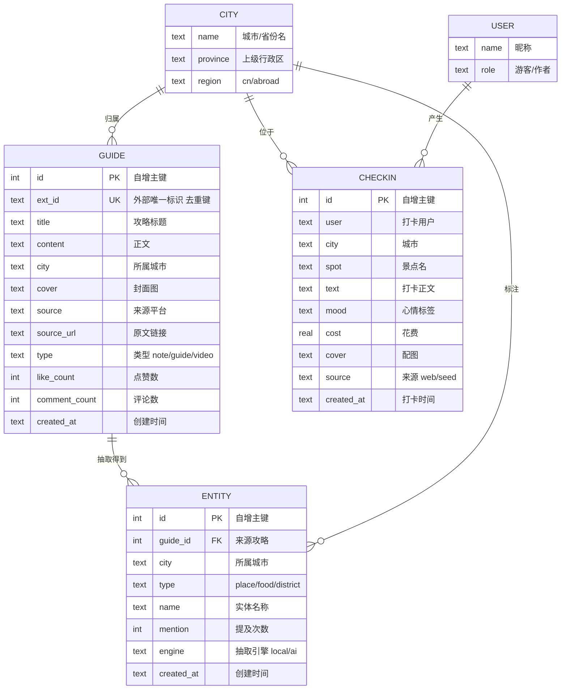

> E-R 图说明：`CITY` 与 `USER` 为逻辑实体，在当前版本中由 `guide.city`、`checkin.city`、`checkin.user` 字段承载（做维度归类与别名映射），尚未独立建表，属于为后续多表规范化预留的设计位。

### 4.2 物理表结构

**guide · 攻略表** —— 攻略与笔记的统一存储，`ext_id` 作为跨源去重键（`crawl-{id}`、`spot-{id}`）。

| 字段 | 类型（PG / SQLite） | 约束 | 说明 |
|---|---|---|---|
| id | SERIAL / INTEGER | PK, AUTOINCREMENT | 主键 |
| ext_id | TEXT | UNIQUE | 外部 ID，重复采集不重复入库 |
| title | TEXT | NOT NULL | 标题 |
| content | TEXT | | 正文 |
| city | TEXT | INDEX | 所属城市 |
| cover | TEXT | | 封面图 URL |
| source | TEXT | | 来源（小红书 / B站 / 抖音 / system） |
| source_url | TEXT | | 原文链接 |
| type | TEXT | | note / guide / video |
| like_count | INTEGER | DEFAULT 0 | 点赞 |
| comment_count | INTEGER | DEFAULT 0 | 评论 |
| created_at | TEXT | | 创建时间 |

**checkin · 打卡表** —— 用户足迹原始记录，同时作为「地图点亮」与「足迹分析」的数据源。

| 字段 | 类型 | 约束 | 说明 |
|---|---|---|---|
| id | SERIAL / INTEGER | PK | 主键 |
| user | TEXT | | 打卡用户（PG 需 `"user"` 加引号） |
| city | TEXT | INDEX | 城市 |
| spot | TEXT | | 景点名 |
| text | TEXT | | 打卡正文 |
| mood | TEXT | | 心情标签（😌 治愈放松 等） |
| cost | DOUBLE PRECISION / REAL | DEFAULT 0 | 花费 |
| cover | TEXT | | 配图 |
| source | TEXT | DEFAULT 'web' | web 用户提交 / seed 种子 |
| created_at | TEXT | | 打卡时间 |

**entity · 结构化实体表** —— AI（或本地规则）从攻略正文抽取的地名 / 美食 / 商圈，是「城市旅游资源图谱」的载体。

| 字段 | 类型 | 约束 | 说明 |
|---|---|---|---|
| id | SERIAL / INTEGER | PK | 主键 |
| guide_id | INTEGER | FK → guide.id | 来源攻略 |
| city | TEXT | INDEX | 所属城市 |
| type | TEXT | UNIQUE(guide_id, type, name) | place / food / district |
| name | TEXT | INDEX | 实体名 |
| mention | INTEGER | DEFAULT 1 | 提及次数，用于热度排序 |
| engine | TEXT | | local 规则抽取 / ai 大模型 |
| created_at | TEXT | | 创建时间 |

**索引**：`idx_guide_city`、`idx_check_city`、`idx_entity_name`。

### 4.3 数据库表关系图

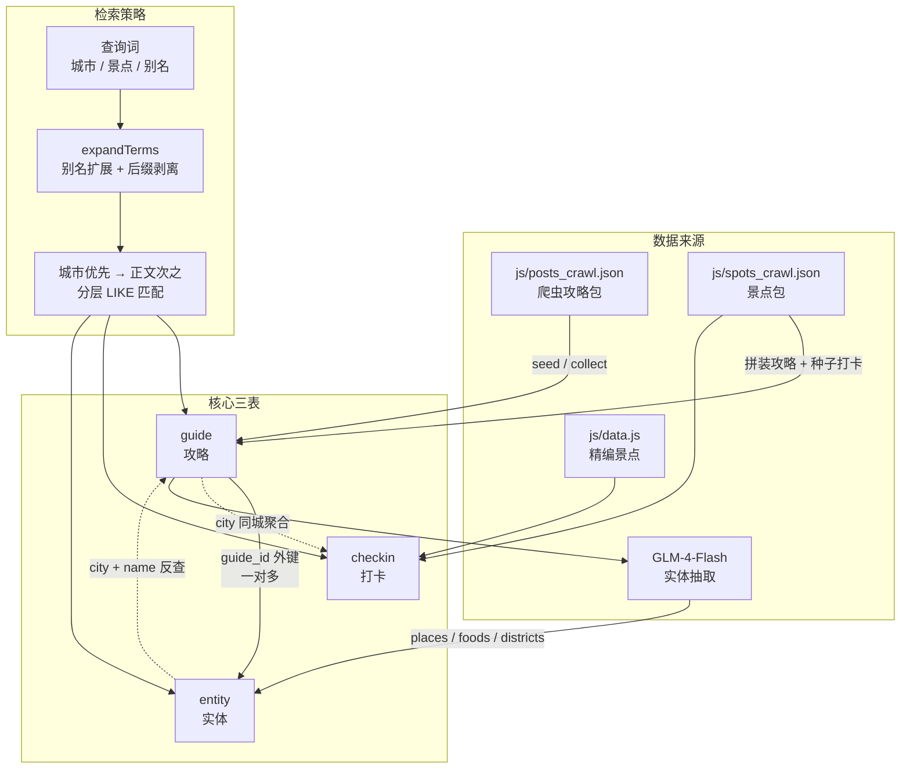

### 4.4 双数据库适配

[db.js](file:///d:/Documents/Tencent%20Files/%E6%AF%95%E8%AE%BE/%E6%AF%95%E8%AE%BE/backend/src/db.js) 用一套接口屏蔽两个驱动差异，业务代码不感知数据库类型：

| 差异点 | PostgreSQL | SQLite |
|---|---|---|
| 占位符 | `?` 自动转 `$1, $2...` | 原生 `?` |
| 自增主键 | `SERIAL` + `RETURNING id` | `AUTOINCREMENT` + `lastInsertRowid` |
| 忽略重复 | `ON CONFLICT DO NOTHING` | `INSERT OR IGNORE` |
| 保留字 | 需 `"user"` 加引号 | 直接 `user` |
| 事务 | `client.query('BEGIN/COMMIT/ROLLBACK')` | `BEGIN IMMEDIATE` |
| 启用条件 | 存在 `DATABASE_URL` 环境变量 | 未配置时自动降级 |

## 五、主要内容与模块分析

### 5.1 模块总览

| 模块 | 页面 | 核心能力 | 关键实现 |
|---|---|---|---|
| AI 行程规划 | `ai.html` | 表单采集 → 多日可执行行程 → 预算与天气备案 | [plan.js](file:///d:/Documents/Tencent%20Files/%E6%AF%95%E8%AE%BE/%E6%AF%95%E8%AE%BE/backend/src/plan.js) · [planner.js](file:///d:/Documents/Tencent%20Files/%E6%AF%95%E8%AE%BE/%E6%AF%95%E8%AE%BE/backend/src/planner.js) |
| 手帐地图 | `map.html` | 中国分省点亮 / 世界环球航线 / 手绘山脉 | [globe.js](file:///d:/Documents/Tencent%20Files/%E6%AF%95%E8%AE%BE/%E6%AF%95%E8%AE%BE/js/globe.js) · ECharts geo |
| 旅行转盘 | `wheel.html` | 国内省→市 / 国外国→州 两级候选随机 | Canvas 扇形绘制 + 缓动 |
| 旅行社区 | `community.html` | 多平台攻略聚合、4K 精选、视频/Plog 分类 | [community.js](file:///d:/Documents/Tencent%20Files/%E6%AF%95%E8%AE%BE/%E6%AF%95%E8%AE%BE/js/community.js) |
| 站内搜索 | `search.html` | 攻略 + 打卡 + 实体三路联合检索 | [db.js searchGuides](file:///d:/Documents/Tencent%20Files/%E6%AF%95%E8%AE%BE/%E6%AF%95%E8%AE%BE/backend/src/db.js#L437-L455) |
| 内容采集 | 后端 | 爬虫包 / 景点库兜底 → 入库 → AI 抽取 | [collector.js](file:///d:/Documents/Tencent%20Files/%E6%AF%95%E8%AE%BE/%E6%AF%95%E8%AE%BE/backend/src/collector.js) |
| 打卡记录 | `checkin.html` | 表单录入、心情与花费、一键成册 | [routes.js](file:///d:/Documents/Tencent%20Files/%E6%AF%95%E8%AE%BE/%E6%AF%95%E8%AE%BE/backend/src/routes.js#L132-L133) |
| 旅行纪念册 | `memories.html` | 图文回顾、BGM、可播放相册 | localStorage + 播放器 |
| 足迹分析 | `analysis.html` | 城市/省份覆盖率、花费分布、AI 打卡点评 | 统计聚合 + 大模型 |
| 跟着小说去旅行 | `novel.html` | 文学地标 → 现实目的地映射 | 静态策划 + AI 跳转 |
| 创作台 | `workbench.html` | 攻略草稿、素材管理与发布 | [publish.html](file:///d:/Documents/Tencent%20Files/%E6%AF%95%E8%AE%BE/%E6%AF%95%E8%AE%BE/publish.html) |

### 5.2 模块一：AI 行程规划（核心算法）

**问题**：把 N 个带经纬度的景点，合理分配到 D 天，且满足「同一天不折返、每天数量均衡、同名不重复」。

**解法**：三步纯函数流水线，前后端共用同一套逻辑（后端 [planner.js](file:///d:/Documents/Tencent%20Files/%E6%AF%95%E8%AE%BE/%E6%AF%95%E8%AE%BE/backend/src/planner.js)，前端 `js/ai.js` 内 `offlinePlanner` 为等价离线兜底实现）。

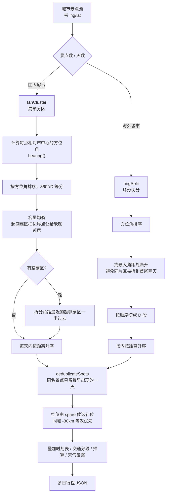

设计要点：

- **为什么用方位角而非 K-Means**：聚类结果随初始质心漂移、天与天边界不稳定；方位角分区在平面上等价于「把城市切成若干扇区」，几何意义明确、可解释，且天然避免天天绕着同一片区来回跑。
- **边界自适应**：景点常挤在市中心 90° 范围内，硬均分会出现「某天 8 个、某天 0 个」。因此加入容量均衡与空扇区拆分两步修正。
- **国内 / 海外双策略**：国内景点分布成片，适合扇形；海外精编景点是离散点，改用「最大空档切环」，保证每天景点在地理上连续。
- **可解释性**：前端展示「本日路线位于市中心 50°–275° 方位角内」，让用户看懂行程为什么这样排。

### 5.3 模块二：内容采集与 AI 实体抽取

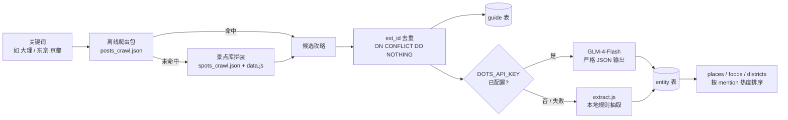

工程取舍：

- **AI 不作为单点依赖**：`extractEntities` 失败即降级到本地规则，保证断网 / 无 Key 时功能可用，`engine` 字段记录本次实际使用的引擎便于排查。
- **限流保护**：`AI_MAX_PER_REQUEST`（默认 5）限制单请求内的模型调用次数，避免一次采集打爆配额。
- **组合目的地**：`东京 · 京都` 会先拆分再逐个检索，避免整串关键词匹配不到任何数据。
- **检索防误命中**：搜「大理」时不能被标题含「大」字的西藏帖命中，因此 `expandTerms` 丢弃长度 < 2 的词，并对长词做后缀剥离（`大理古城` → `大理`）。

### 5.4 模块三：手帐地图与足迹点亮

- **双视图**：中国分省着色图 + 世界环球航线图，均基于 ECharts `geo` 本地内置底图（不依赖外网 CDN，弱网可用）。
- **手绘风渲染**：分省随机柔和色、手绘山脉符号、米黄纸张底，配合「已点亮」金色描边突出用户足迹。
- **交互**：滚轮缩放、拖拽平移、省份名开关、视图重置；航线图按打卡顺序连线并带流向动画。
- **足迹来源**：`checkin` 表记录 + 前端 `localStorage` 本地记录，两条来源合并去重后驱动点亮数量。
- **性能**：单层 `geo` 配置（series 直接指向 `geoIndex`），避免多层重复渲染导致的地图空白与卡顿。

### 5.5 模块四：旅行社区与多平台攻略

- **聚合维度**：按平台（抖音 / 小红书 / 快手 / Instagram / YouTube / B站）× 内容类型（打卡视频 / Plog）× 地区（国内 / 国外）交叉筛选。
- **精选 4K 区**：卡片点击进入弹窗，弹窗内可再放大进入灯箱，支持半屏 / 全屏 / 滚轮缩放，Escape 分级关闭。
- **防盗链兜底**：外链图片加载失败自动降级占位图，并用 `referrerpolicy` 规避防盗链，避免大面积裂图。
- **搜索**：匹配标题、正文、地点与词条，结果按城市优先排序。

### 5.6 模块五：打卡与旅行纪念册

- **打卡录入**：城市、景点、正文、心情、花费、配图，写入后端 `checkin` 表，同时落本地。日期控件统一圆角并高亮，表单分区布局。
- **一键成册**：把所选打卡聚合成纪念册页，支持图文混排、BGM 选择与视频播放。
- **AI 点评**：足迹分析页对打卡数据做实时汇总，由大模型给出个性化旅行总结。
- **数据复用**：纪念册与地图点亮共用同一份打卡数据源，避免重复录入。

## 六、技术栈

| 层 | 选型 |
|---|---|
| 前端 | 原生 HTML / CSS / JavaScript（无框架构建，直接静态部署）、ECharts 5（地图）、Canvas（转盘） |
| 后端 | Node.js 18+、Express 4 |
| 数据库 | PostgreSQL（生产）/ SQLite + better-sqlite3（本地） |
| AI | 智谱 GLM-4-Flash（OpenAI 兼容协议），失败降级本地规则抽取 |
| 地图数据 | ECharts 内置 geo JSON、高德地图 API、OSM Overpass |
| 部署 | GitHub Pages（前端）+ Render（后端 + Postgres），`render.yaml` 声明式配置 |
| 图片资源 | 文生图 API 生成，WebP 压缩后入库 |

## 七、接口一览

Base URL：`https://wandergo-backend-6i1z.onrender.com/api`

| 方法 | 路径 | 说明 |
|---|---|---|
| GET | `/health` | 健康检查，返回数据库方言、AI 配置状态与数据统计 |
| GET | `/search?q=` | 联合检索：攻略 + 打卡 + 实体，城市优先分层匹配 |
| GET | `/post/list` | 帖子分页列表（社区流） |
| POST | `/checkin`、`/checkin/add` | 新增打卡记录 |
| POST | `/collect-guide` | 采集攻略 → 入库 → AI 抽取实体 |
| POST | `/chat` | 大模型通用对话（攻略问答） |
| GET | `/videos` | 视频攻略列表 |
| POST | `/analyze-video` | 视频文案解析与结构化 |
| POST | `/plan/route` | 生成多日行程（分区 + 交通 + 预算） |
| GET | `/plan/spots` | 城市景点池查询 |

## 八、本地运行

```bash
# 1. 启动后端（默认 8080，未配 DATABASE_URL 时用 SQLite）
cd backend
npm install
npm run dev

# 2. 启动前端静态服务（另开终端）
npx serve -l 8099 .

# 3. 浏览器访问
#    http://127.0.0.1:8099/index.html
```

环境变量（[.env.example](file:///d:/Documents/Tencent%20Files/%E6%AF%95%E8%AE%BE/%E6%AF%95%E8%AE%BE/backend/.env.example)）：

| 变量 | 说明 |
|---|---|
| `DATABASE_URL` | PostgreSQL 连接串；缺省则用 SQLite |
| `DOTS_API_KEY` | 大模型 API Key；缺省则全量走本地规则抽取 |
| `DOTS_API_BASE` / `DOTS_MODEL` | 模型服务地址与模型名，默认智谱 `glm-4-flash` |
| `AI_MAX_PER_REQUEST` | 单次采集最多调用模型次数，默认 5 |
| `PORT` | 后端端口，默认 8080 |

## 九、目录结构

```
bishe-wandergo/
├── index.html / ai.html / map.html / wheel.html / ...   # 19 个功能页面
├── css/            # 视觉体系：style / pages / community / search / guide / admin
├── js/
│   ├── core.js     # 公共壳：导航、弹窗、灯箱、滚动动效
│   ├── api.js      # 请求封装与双环境 BaseURL
│   ├── data.js     # 精编景点库（含坐标、描述、标签）
│   ├── globe.js    # ECharts 地图与环球航线
│   ├── lib/china.js# 内置中国地图 geo JSON
│   └── *.json      # 爬虫攻略包、景点包、帖子包
├── img/shots/      # 首页案例截图（WebP，50 张）
├── backend/
│   ├── src/
│   │   ├── server.js    # Express 启动与静态托管
│   │   ├── routes.js    # 11 个 API 路由
│   │   ├── db.js        # 双数据库适配 + 建表 + 种子 + 检索
│   │   ├── collector.js # 采集编排
│   │   ├── planner.js   # 行程分区纯函数
│   │   ├── plan.js      # 景点池 / 交通 / 预算
│   │   ├── extract.js   # 本地规则实体抽取
│   │   ├── dots.js      # 大模型适配层
│   │   └── services/    # 高德 / OSM / 景区检索
│   └── data/            # SQLite 数据文件与 OSM 缓存
└── render.yaml          # Render 部署声明
```

## 十、版本与进度

| 分支 | 用途 |
|---|---|
| `deploy-1029` | **当前开发主线**，与 GitHub Pages 同步部署 |
| `main` | 早期多服务拆分版（`wandergo-backend` / `wandergo-platform` / `wandergo-crawler`），保留归档 |

近期已修复的关键问题：地图单层 geo 渲染中断、ECharts 底图外网依赖、社区帖子封面裂图、行程生成返回错误城市、2 天被拆成 4 天、同日同义景点重复、行程支持拖拽调配、AI 结果页截图空白。

---

<div align="center">

让世界，成为你的下一站。

</div>
